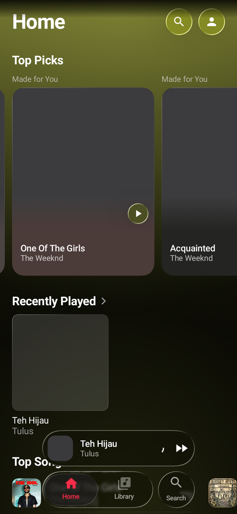
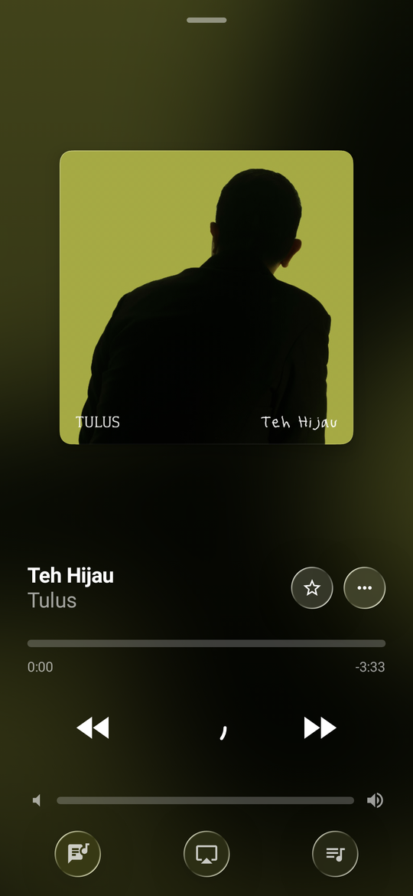
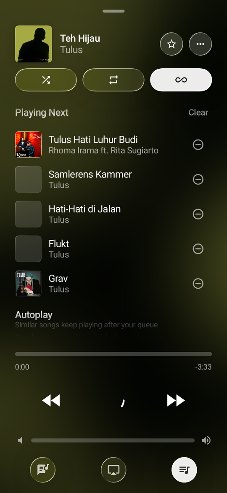
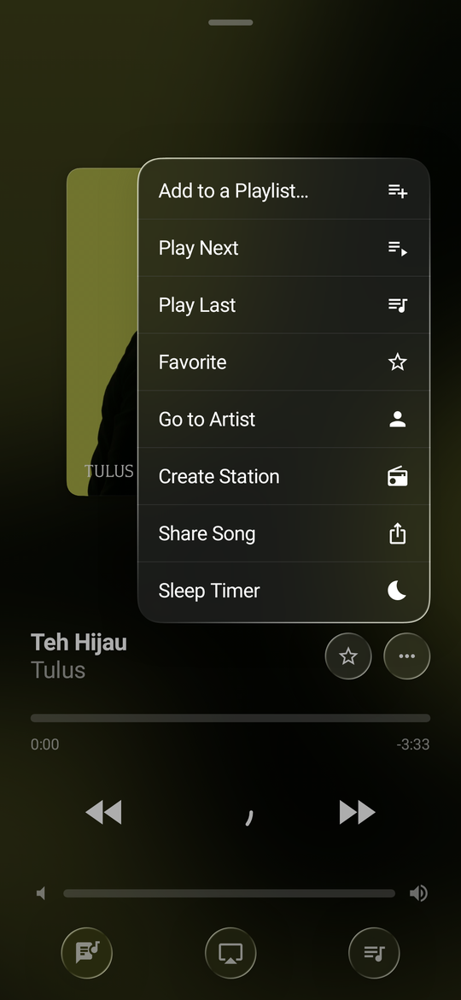
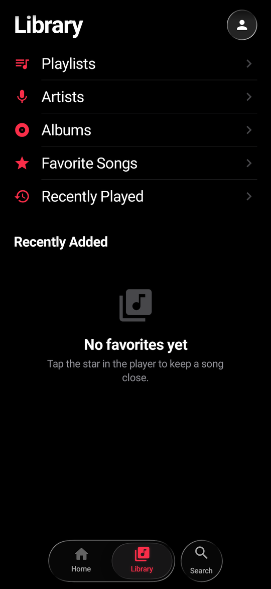
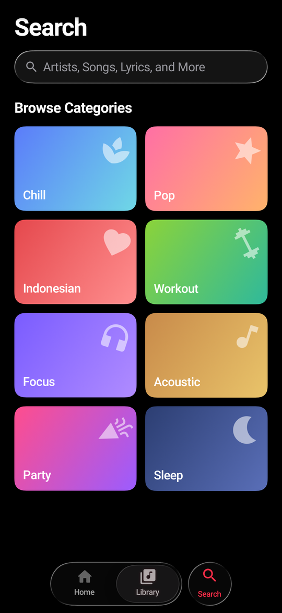
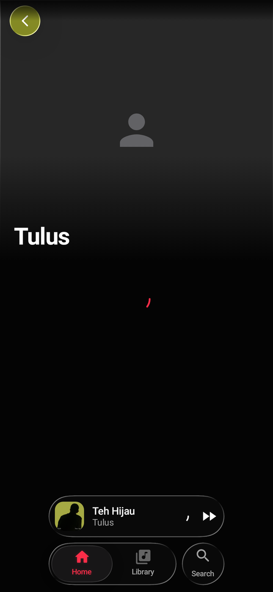
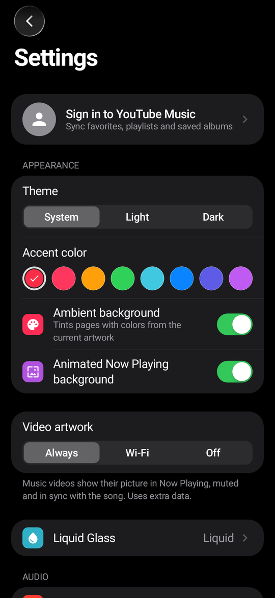
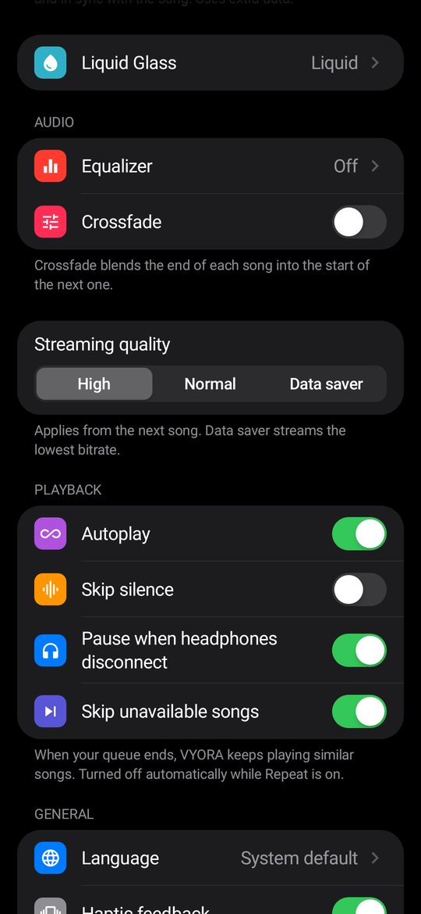

# VYORA

Pemutar musik Android (Jetpack Compose + Media3) dengan katalog YouTube Music lewat
NewPipe Extractor, UI bergaya iOS 26 dengan Liquid Glass. Library disimpan di Room dan
bisa disinkronkan dua arah dengan akun YouTube Music.

Versi terbaru: **1.4.1**. APK siap pasang ada di halaman
[Releases](../../releases).

## Tampilan

| Home (latar ambient) | Now Playing | Antrean | Menu lagu |
|---|---|---|---|
|  |  |  |  |

| Library | Cari | Artis | Akun YouTube Music |
|---|---|---|---|
|  |  |  |  |

| Settings | Settings (audio & pemutaran) |
|---|---|
|  |  |

Screenshot diambil otomatis dari `ScreenshotTest` (Robolectric). Di sana efek blur tidak
dirender, jadi di HP asli latar Now Playing terlihat lebih lembut.

## Fitur

- Katalog YouTube Music: cari lagu, album, artis, playlist, lirik tersinkron.
- Now Playing ala iOS 26 dengan latar artwork yang bergerak. Untuk video musik, artwork
  diganti videonya sendiri dan warna latarnya ikut warna video.
- Liquid Glass untuk tab bar, mini player, dan kontrol. Bisa diatur detail atau dimatikan
  (ada tampilan cadangan yang tetap rapi).
- Equalizer 10 band (DynamicsProcessing + limiter, jadi suara tidak pecah atau mendem),
  bass, surround, loudness.
- Crossfade, autoplay lagu serupa, lewati hening, sleep timer, cache lagu di disk.
- Library di Room, sinkron dua arah dengan akun YouTube Music.
- 6 bahasa: Indonesia, Inggris, Melayu, Spanyol, Jepang, dan bahasa sistem.

## Catatan versi

### 1.4.1
- **Latar ambient** sekarang benar-benar terlihat. Sebelumnya warnanya terlalu tipis (sekitar
  16% dari warna yang sudah digelapkan), jadi halaman tetap hitam. Sekarang warna lagu
  turun dari atas halaman seperti Apple Music dan ada cahaya lembut di dekat tab bar. Kalau
  dimatikan atau tidak ada lagu, halaman kembali polos.
- **Latar Now Playing bergerak** sekarang benar-benar bergerak: dua salinan artwork berputar
  pelan berlawanan arah (satu putaran 40 detik) dan berhenti di tempat saat pause. Dulu
  geraknya hanya bergeser 8% dalam 60 detik, jadi tidak terasa. Di Android 11 ke bawah
  latarnya kosong; sekarang tampil blur dari gambar kecil yang diperbesar.
- Batas ukuran cache langsung memakai nilai Settings, juga sebelum service pemutar jalan.
- Perubahan Settings langsung disimpan saat aplikasi ditutup, jadi tidak hilang kalau
  aplikasi ditutup tepat setelah mengubah setelan.

### 1.4.0
- Data dipindah ke Room. Data versi 1.x dipindah otomatis.
- Login akun YouTube Music dan sinkron favorit, playlist, album.

### 1.3.0
- Perbaikan audio mendem (pemilihan stream, headroom EQ, crossfade), video sebagai artwork,
  tampilan saat Liquid Glass mati, struktur project dirapikan.

## Build

```bash
./gradlew assembleDebug      # app/build/outputs/apk/debug/
./gradlew assembleRelease    # app/build/outputs/apk/release/ (R8, ditandatangani)
./gradlew testDebugUnitTest  # unit test
```

Butuh JDK 17 dan Android SDK 36. Lokasi SDK diisi Android Studio di `local.properties`.

### Signing

`app/keystore/release-key.jks` + `app/keystore.properties` adalah **kunci UJI COBA** untuk
build percobaan, bukan untuk rilis Play Store. Untuk rilis sungguhan buat keystore baru dan
simpan di luar repo (atau pakai variabel `VYORA_KEYSTORE`, `VYORA_KEYSTORE_PASSWORD`,
`VYORA_KEY_ALIAS`, `VYORA_KEY_PASSWORD`). Keduanya ada di `.gitignore`, jadi tidak ikut
ke GitHub. Tanpa keystore, `assembleRelease` tetap jalan tapi APK-nya belum ditandatangani;
pakai `assembleDebug` untuk mencoba.

## Struktur

```
com.vyora.music
├── MainActivity.kt, VyoraApp.kt   Activity (tema, bahasa) dan Application (cache gambar Coil)
├── core/                          utilitas lintas modul (LocaleHelper)
├── data/
│   ├── youtube/                   NewPipe: pencarian, playlist, radio, pemilihan stream
│   │   ├── YouTubeClient          pencarian & halaman
│   │   ├── StreamResolver         ekstraksi stream + cache per video + header per klien
│   │   ├── StreamSelector         aturan memilih audio/video (tanpa DRC, track asli)
│   │   ├── SimpleItem             model + format JSON bersama
│   │   └── YouTubeConfig          semua konstanta YouTube
│   ├── db/                        Room: entity, DAO, VyoraDatabase, impor data 1.x
│   ├── account/                   akun YouTube Music + sinkronisasi
│   │   ├── AccountStore           sesi login (dienkripsi Android Keystore)
│   │   ├── YouTubeMusicApi        request InnerTube WEB_REMIX yang sudah login
│   │   ├── InnerTubeParser        pembaca respons (diuji dengan data asli)
│   │   └── SyncEngine             push perubahan + tarik favorit/playlist/album
│   ├── library/                   LibraryManager & SearchHistory (di atas Room), home feed
│   ├── lyrics/                    lirik LRCLIB
│   └── settings/                  AppSettings + SettingsRepository
├── playback/
│   ├── PlayerManager, MediaItems  sisi UI (MediaController)
│   ├── service/                   PlaybackService, Crossfader, QueueStore, urutan shuffle
│   ├── source/                    DataSource YouTube + MediaCache (cache lagu di disk)
│   ├── audio/                     equalizer 10 band (DynamicsProcessing + limiter)
│   └── video/                     pemutar video artwork (tanpa suara, sinkron lagu)
└── ui/
    ├── VyoraAppRoot.kt            navigasi, bilah tab, mini player, sheet pemutar
    ├── screens/                   Home, Search, Library, Artist, Playlist, Settings
    ├── player/                    Now Playing, mini player, video artwork
    ├── components/, design/       komponen bersama, glass ringan, ambient
    ├── glass/                     mesin Liquid Glass (vendored, lihat NOTICE.md)
    └── theme/                     warna, palet, tipografi
```

## Penyimpanan

| Data | Lokasi |
|---|---|
| Favorit, riwayat, playlist, album tersimpan, riwayat pencarian | Room `databases/vyora.db` |
| Antrean terakhir | Room, tabel `queue` + `queue_state` |
| Perubahan yang belum terkirim ke YouTube | Room, tabel `sync_actions` |
| Sesi akun YouTube | SharedPreferences `vyora_account` (AES-GCM, kunci di Android Keystore, tidak ikut backup) |
| Pengaturan | SharedPreferences `vyora_settings` (ditulis tertunda 300 ms) |
| Cache lagu & video artwork | `cache/media_cache` (LRU, ukuran diatur di Pengaturan) |
| Cache gambar | `cache/image_cache` (LRU 80 MB) |

Skema Room tiap versi diekspor ke `app/schemas/`. Menaikkan versi database wajib disertai
`Migration` (jangan pakai destructive fallback, ini library pengguna). Data dari VYORA 1.x
(DataStore, SharedPreferences, `queue.json`) dipindah otomatis sekali saat pertama dibuka.

## Akun YouTube Music

Pengaturan > Akun. Login lewat halaman Google di WebView (cookie sesi diambil setelah
mendarat di music.youtube.com), atau tempel header Cookie dari browser. Yang disinkronkan
dua arah: lagu yang disukai, playlist milik sendiri (buat, ganti nama, hapus, tambah/hapus
lagu), playlist orang lain dan album yang disimpan. Riwayat putar tidak dikirim. Perubahan
saat offline diantre dan dikirim saat online. Sinkron otomatis saat aplikasi dibuka jika
terakhir lebih dari 30 menit lalu.

## Lisensi

GPL-3.0, lihat `LICENSE` dan `NOTICE.md`.
